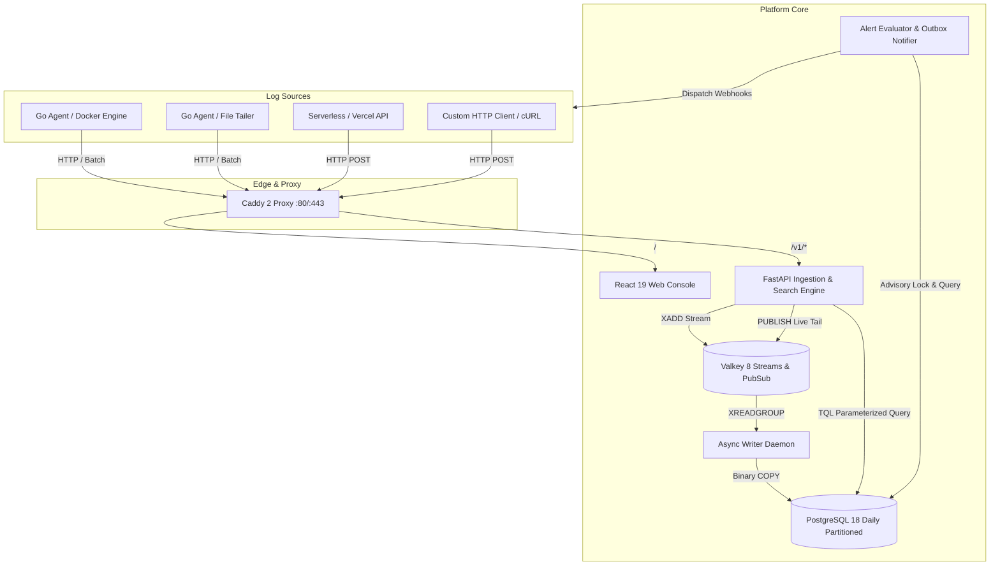
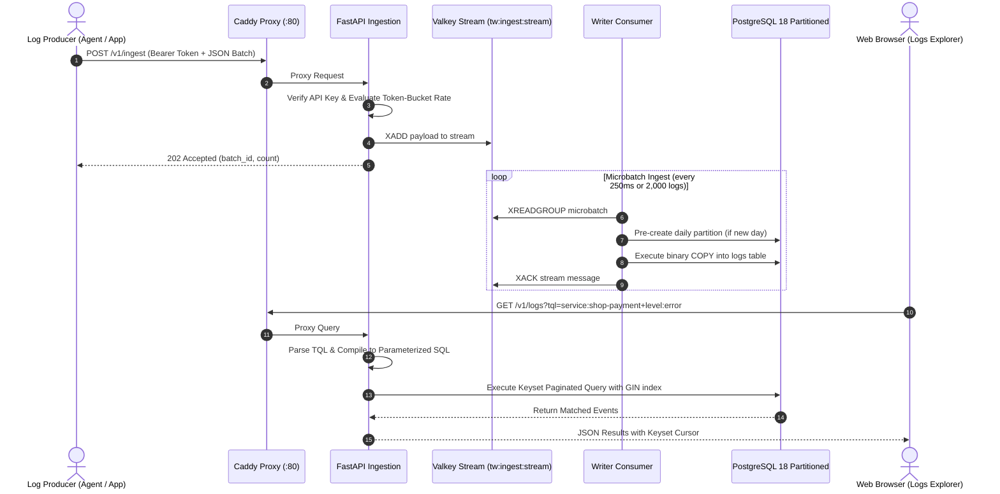

# Tailwatch

Tailwatch is a self-hosted log aggregation, search, and alerting platform designed for lean engineering teams and modern infrastructure. It deploys via a single Docker Compose specification, collects logs via a lightweight Go agent or direct HTTP endpoints, buffers through Valkey Streams, persists into a daily-partitioned PostgreSQL 18 engine with binary ingest paths, and provides a Vercel-inspired web console.

## Architecture



### Ingestion and Query Data Flow



## System Components

- **Edge Proxy (Caddy 2)**: Automated TLS certificate provisioning, HTTP/2 termination, reverse proxying, and static distribution serving.
- **API Server (FastAPI)**: Token-bucket rate limiting, Argon2id authentication, SSE live tail broadcasting, and TQL (Tailwatch Query Language) compilation.
- **Buffer (Valkey 8)**: Append-only memory queue handling ingest bursts up to 10,000 events per second.
- **Writer Daemon**: Background worker consuming microbatches from Valkey and executing high-throughput binary `COPY` into PostgreSQL.
- **Storage Engine (PostgreSQL 18)**: Native daily range partitioning on `logs`, GIN index acceleration for full-text search, and 1-minute rollup aggregates.
- **Web Console**: High-performance single page application built with React, TypeScript, and pure CSS Modules following the 60-30-10 design system with high-contrast dark and light modes.
- **Agent (Go)**: Static binary with sub-15 MB RAM overhead, multiline joining, RE2 secret redaction, Docker engine socket ingestion, and CRC32C segment disk spooling.
- **Chaos Suite**: Realistic synthetic microservice generator simulating normal operations and distributed system failures with an independent audit ledger for zero-loss verification.

## Project Structure

```
Tailwatch/
├── compose.yaml                  # Production-grade 6-container compose stack
├── compose.chaos.yaml            # Optional chaos simulator profile
├── .env.example                  # Environment configuration template
├── README.md                     # Root technical reference and quick start
│
├── agent/                        # Go static collection agent
│   ├── cmd/agent/                # Cobra CLI entrypoint (run, check, version)
│   ├── pkg/
│   │   ├── config/               # YAML parser with env substitution
│   │   ├── discovery/            # Docker engine socket container collector
│   │   ├── tailer/               # Inode-tracking file tailer & multiline
│   │   ├── masking/              # RE2 secret redaction engine
│   │   ├── spool/                # 16 MiB segment WAL disk spool with CRC32C
│   │   ├── pipeline/             # Buffer channel & worker coordinator
│   │   └── sender/               # HTTP client with jittered backoff
│   ├── go.mod                    # Go module definitions
│   └── README.md                 # Agent deployment and configuration manual
│
├── server/                       # Core backend (API, Writer, Alerts, TQL)
│   ├── src/tailwatch/
│   │   ├── api/                  # FastAPI routers (ingest, search, tail, auth)
│   │   ├── writer/               # Valkey consumer daemon & binary COPY worker
│   │   ├── query/                # TQL lexer, parser, and SQL compiler
│   │   ├── alerting/             # Advisory lock state evaluator & outbox notifier
│   │   ├── core/                 # Argon2id security, settings & exceptions
│   │   ├── db/                   # PostgreSQL 18 schema & partition migration
│   │   └── cli.py                # Command line router (api, writer, migrate)
│   ├── pyproject.toml            # Python package specifications
│   ├── Dockerfile                # Production container definition
│   └── README.md                 # Server architecture and API reference
│
├── web/                          # Vercel-style UI console (React, TypeScript)
│   ├── src/
│   │   ├── components/
│   │   │   ├── layout/Shell/     # Global layout, theme switcher, tab navigation
│   │   │   └── ui/               # Button, Input, LevelPill, StatusChip, Toast
│   │   │       ├── Histogram/    # Canvas density scrubber with brush zoom
│   │   │       ├── QueryBar/     # TQL search input & time range selector
│   │   │       └── Drawer/       # Structured JSON log inspector sheet
│   │   ├── features/
│   │   │   ├── logs/             # LogsExplorer table & search controller
│   │   │   ├── tail/             # LiveTail SSE streaming terminal
│   │   │   ├── alerts/           # AlertsView rule manager & threshold modal
│   │   │   ├── sources/          # SourcesView host heartbeat monitor
│   │   │   ├── system/           # SystemView buffer memory & partition gauges
│   │   │   ├── auth/             # AuthView initial setup & login gates
│   │   │   └── onboarding/       # OnboardingWizard snippet integration helper
│   │   ├── styles/tokens.css     # CSS custom property design tokens (60-30-10)
│   │   └── App.tsx               # Root view coordinator & authentication gate
│   ├── package.json              # Web dependencies
│   ├── Dockerfile                # Static build container
│   └── README.md                 # Web design system and component manual
│
├── chaos/                        # Chaos testing & verification harness
│   ├── generator.py              # Multi-tier microservices synthetic log emitter
│   ├── ledger.py                 # Independent SQLite audit ledger
│   ├── chaosctl.py               # CLI runner and completeness verification tool
│   ├── Dockerfile                # Standalone simulation container
│   └── README.md                 # Chaos manual and scenario catalog
│
└── deploy/                       # Infrastructure configuration
    ├── caddy/Caddyfile           # Reverse proxy routing and cache headers
    └── postgres/postgresql.conf  # PostgreSQL 18 high-throughput tuning
```

## Deployment Profiles

| Profile | Target Size | vCPU | RAM | Partitions Retention | Max Log Burst |
| :--- | :--- | :--- | :--- | :--- | :--- |
| **S** | 1 to 5 nodes | 2 | 4 GB | 14 days | 5,000 / sec |
| **M** | 5 to 20 nodes | 4 | 8 GB | 30 days | 15,000 / sec |
| **L** | 20 to 50 nodes | 8 | 16 GB | 90 days | 35,000 / sec |

## Getting Started

### Prerequisites

- Docker Engine 24.0 or newer
- Docker Compose v2

### Quick Start

1. Clone the repository:
   ```bash
   git clone https://github.com/ADI-2707/Tailwatch.git
   cd Tailwatch
   ```

2. Copy the environment configuration:
   ```bash
   cp .env.example .env
   ```

3. Launch the platform:
   ```bash
   docker compose up --build -d
   ```

4. Access the web interface:
   Open `http://localhost` in your browser. Complete the initial setup wizard to create the administrator account and default project.

## Ingestion API

Log events are accepted at `/v1/ingest` via HTTP POST.

### Authentication
Requests require an API key passed in the `Authorization` header:
```
Authorization: Bearer <API_KEY>
```

### Payload Schema
```json
{
  "batch_id": "batch-100293",
  "events": [
    {
      "ts": "2026-10-18T12:00:00Z",
      "level": "error",
      "service": "billing-service",
      "message": "Failed to charge customer card",
      "fields": {
        "customer_id": "cust_8281",
        "error_code": "CARD_DECLINED",
        "attempt": 2
      }
    }
  ]
}
```

## Tailwatch Query Language (TQL)

The web console and `/v1/logs` search API support TQL expressions:

- Full-text search: `timeout connecting to redis`
- Service filtering: `service:shop-payment`
- Severity filtering: `level:error` or `level:>=warn`
- Structured field filtering: `fields.status_code=500` or `fields.latency_ms:>1000`
- Conjunctions: `service:shop-web level:error fields.status_code=500`

## License

Apache-2.0 License.
