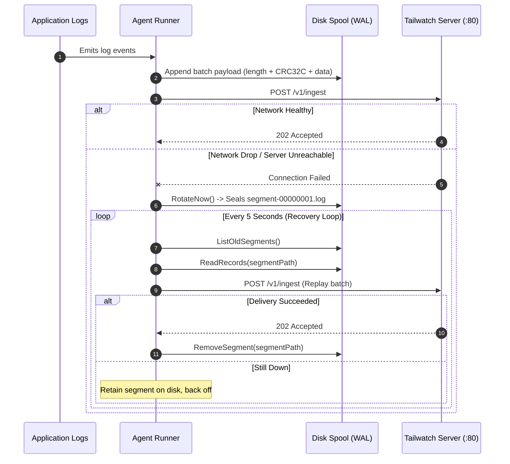

# Tailwatch Agent

A high-performance, single-binary log collection agent written in Go. The Tailwatch Agent operates with a memory footprint under 15 MiB, tails container logs and raw log files, redacts sensitive secrets and PII at the edge, aggregates multiline stack traces, and spools unacknowledged batches to disk in 16 MiB segments with CRC32C checksums during network partitions.

---

## 1. Architecture & Data Flow

```mermaid
graph TD
    subgraph Discovery [Log Collectors]
        DS[/var/run/docker.sock] -->|Container Stdout/Stderr| DCOL[Docker Collector]
        FL[/var/log/*.log] -->|Inode-Tracking Follower| FCOL[File Tailer]
    end

    subgraph Processing [Edge Processing Pipeline]
        DCOL --> MJ[Multiline Joiner: ISO8601 & Stack Traces]
        FCOL --> MJ
        MJ -->|Joined Raw Lines| MSK[RE2 Secret Masker: JWT, AWS, PII]
        MSK -->|Sanitized LogEvent Structs| CH[In-Memory Buffer Channel: 2,000 slots]
    end

    subgraph Transport [Batching, Spooling & Egress]
        CH --> FLUSH{Trigger: 250 Events or 1,000ms}
        FLUSH --> WAL[(16 MiB Segment Disk Spool: CRC32C)]
        FLUSH --> HTTP[HTTP/2 Sender Client: /v1/ingest]
        HTTP -->|202 Accepted| OK[Batch Acknowledged]
        HTTP -->|Network Failure / 5xx| ROT[Rotate Spool Segment]
        ROT --> REC[Background Spool Replay Loop]
        REC -->|Read Closed Segments| HTTP
    end
```

---

## 2. Component Breakdown: What Each File Does

| Path | Component | Responsibility |
| :--- | :--- | :--- |
| `cmd/tailwatch-agent/main.go` | **CLI Entrypoint** | Cobra-powered CLI supporting `run` (foreground agent daemon) and `version` commands with OS signal termination (`SIGINT`, `SIGTERM`). |
| `internal/config/config.go` | **Config Parser** | Loads YAML configuration files with dynamic `${ENV_VAR}` expansion, validating server endpoints, host identifiers, and buffer limits. |
| `internal/mask/mask.go` | **RE2 Secret Redaction** | High-speed regular expression masker redacting JWT tokens, AWS keys (`AKIA...`), Bearer headers, private keys, credit cards, and sensitive map fields. |
| `internal/multiline/multiline.go` | **Multiline Aggregator** | Buffers indented exception stack traces and multi-line errors (e.g. Python tracebacks, Go panics, Java errors) into unified single events. |
| `internal/pipeline/runner.go` | **Pipeline Coordinator** | Coordinates collectors, in-memory buffering, periodic batch flushing, secret redaction, and background WAL spool playback routines. |
| `internal/sender/sender.go` | **HTTP Transport** | Sends compressed JSON batches to the Tailwatch server `/v1/ingest` endpoint with jittered exponential backoff and timeout controls. |
| `internal/source/docker/collector.go` | **Docker Collector** | Connects to `/var/run/docker.sock` to tail multiplexed stdout and stderr streams of running containers in real time. |
| `internal/source/file/tailer.go` | **File Tailer** | Scans log file paths, tracks read offsets and file inodes, and streams new lines as they are appended to disk. |
| `internal/spool/spool.go` | **Disk WAL Spooler** | Append-only write-ahead log splitting data into 16 MiB segment files with BigEndian length headers and CRC32C integrity checksums. |
| `pkg/protocol/types.go` | **Wire Schemas** | Core Go data structures defining `LogEvent`, `IngestBatch`, and `AgentMetadata` matching the backend API contract. |

---

## 3. Offline Spool Replay & Durability Flow



---

## 4. Project Directory Tree

```
agent/
├── cmd/
│   └── tailwatch-agent/
│       └── main.go               # Cobra CLI entrypoint (run, version)
├── internal/
│   ├── config/
│   │   └── config.go             # YAML parser and environment interpolation
│   ├── mask/
│   │   ├── mask.go               # RE2 secret redaction engine
│   │   └── mask_test.go          # Redaction unit tests (JWT, AWS, PII)
│   ├── multiline/
│   │   ├── multiline.go          # Stack trace joining and grouping engine
│   │   └── multiline_test.go     # ISO8601 & traceback test suite
│   ├── pipeline/
│   │   └── runner.go             # In-memory channel buffer & spool replay loop
│   ├── sender/
│   │   └── sender.go             # HTTP batch client with exponential backoff
│   ├── source/
│   │   ├── docker/
│   │   │   └── collector.go      # Docker socket stream collector
│   │   └── file/
│   │       └── tailer.go         # Inode file reader and offset tracker
│   └── spool/
│       ├── spool.go              # 16 MiB segment disk spooler with CRC32C
│       └── spool_test.go         # Append, rotation, and recovery tests
├── pkg/
│   └── protocol/
│       └── types.go              # Shared Go wire schemas
├── go.mod                        # Go module definition
├── go.sum                        # Cryptographic dependency checksums
└── README.md                     # Technical reference manual
```

---

## 5. Configuration Reference

```yaml
server:
  url: "http://localhost/v1/ingest"
  api_key: "twk_live_test_key_master"
  insecure: false

host:
  name: "prod-node-01"

batch:
  max_events: 250
  max_age: 1s

spool:
  dir: "/var/lib/tailwatch/spool"
  max_size_mb: 512

sources:
  - type: "file"
    service: "nginx"
    paths:
      - "/var/log/nginx/*.log"
```

---

## 6. Build and Verification

### Build Binary
```bash
go build -o tailwatch-agent ./cmd/tailwatch-agent
```

### Run Unit Tests
```bash
go test -v ./...
```
