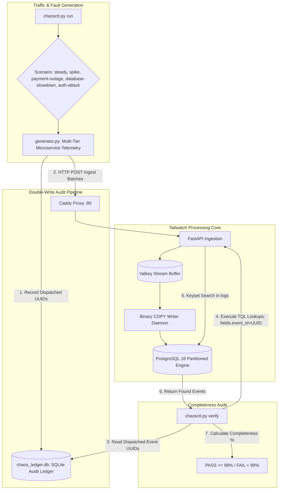

# Tailwatch Chaos Suite

A microservices traffic simulation engine, failure scenario injector, and independent audit ledger designed to stress-test Tailwatch under high-concurrency loads and verify zero-loss log ingestion.

---

## 1. Simulation & Verification Flow



---

## 2. Component Breakdown: What Each File Does

| Path | Component | Responsibility |
| :--- | :--- | :--- |
| `generator.py` | **Synthetic Microservices Emitter** | Generates realistic log events across five services (`shop-web`, `shop-payment`, `shop-inventory`, `shop-auth`, `shop-worker`) simulating normal traffic and production failures. |
| `ledger.py` | **SQLite Audit Ledger** | Standalone SQLite database (`chaos_ledger.db`) storing every generated event ID, timestamp, level, and scenario before network transmission. |
| `chaosctl.py` | **Chaos CLI Controller** | Command-line interface providing `run` (continuous scenario traffic injector) and `verify` (end-to-end completeness auditor). |
| `Dockerfile` | **Simulation Container** | Standalone container packaging Python dependencies to run chaos simulations in Docker networks. |

---

## 3. Failure Scenarios

| Scenario | Simulated Incident | Injected Telemetry Characteristics |
| :--- | :--- | :--- |
| `steady` | Baseline normal operations | Balanced mix of HTTP 200/404 responses, latency under 120ms, primarily INFO/DEBUG logs. |
| `spike` | 10x sudden traffic surge | Elevated concurrency, active sessions between 5,000–15,000, latency up to 400ms. |
| `payment-outage` | Payment gateway timeout | Gateway timeouts (504), connection timeouts to `api.stripe.com`, stack traces, ERROR and FATAL severities. |
| `database-slowdown` | Database connection pool lockup | Slow queries on inventory tables (>3,000ms), lock acquisition warnings, pool saturation (50/50 busy). |
| `auth-attack` | Brute-force credential stuffing | High-frequency 401 Unauthorized responses, varying client IPs, automated scanner user agents (e.g. Hydra). |

---

## 4. Usage & Verification

### 1. Run Steady-State Traffic
Generate 50 logs/second for 10 seconds:
```bash
python -m chaos.chaosctl run --scenario steady --rate 50 --duration 10 --batch-size 25
```

### 2. Inject Distributed Failure Scenarios
```bash
# Inject payment gateway timeout failure
python -m chaos.chaosctl run --scenario payment-outage --rate 25 --duration 10

# Inject database lock contention
python -m chaos.chaosctl run --scenario database-slowdown --rate 25 --duration 10

# Inject credential stuffing attack
python -m chaos.chaosctl run --scenario auth-attack --rate 50 --duration 10
```

### 3. Verify Zero-Loss Ingestion Completeness
Audits the local SQLite ledger records against the Tailwatch search API:
```bash
python -m chaos.chaosctl verify
```

Expected verification output:
```text
Verifying 500 chaos events against Tailwatch at http://localhost...
Verification Result:
Sample checked: 50 events
Verified found: 50 events
Delivery completeness: 100.0%
PASS: Tailwatch verified zero-loss log ingestion.
```
