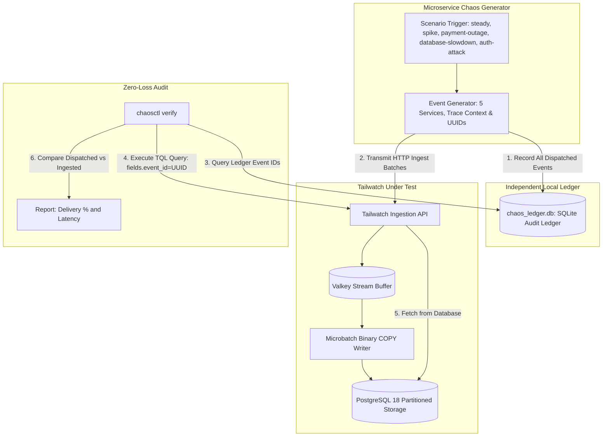

# Tailwatch Chaos Suite

A synthetic microservices traffic generator, fault injection engine, and verification harness designed to stress-test Tailwatch under realistic production loads and failure conditions.

## Architecture & Verification Flow



## Architecture & Principles

The Chaos Suite simulates an e-commerce platform composed of five interdependent services:
- `shop-web`: User web application routing, cart actions, and product queries.
- `shop-payment`: Payment processing gateway integrations and transaction handlers.
- `shop-inventory`: Warehouse catalog queries and stock locking.
- `shop-auth`: User authentication, session issuance, and login attempts.
- `shop-worker`: Background job processor for order fulfillment and email dispatches.

### Fault Scenarios

| Scenario | Simulated Failure Condition | Injected Telemetry |
| :--- | :--- | :--- |
| `steady` | Baseline continuous operation | HTTP 200/404, info/debug logs, p50 latency under 80ms |
| `spike` | 10x traffic surge | High concurrency events, elevated warning logs |
| `payment-outage` | Third-party payment gateway failure | HTTP 504 gateway timeouts, connection drop stack traces, fatal/error severities |
| `database-slowdown` | Database connection saturation | High query latency (>3000ms), lock acquisition warnings on inventory tables |
| `auth-attack` | Distributed brute force credential stuffing | Rapid HTTP 401 unauthorized attempts with varying user agents |

### Audit Ledger & Completeness Verification

The generator writes every generated event ID, batch ID, service name, and timestamp into an independent SQLite database (`chaos_ledger.db`) before transmitting the payload to Tailwatch.

The verification tool (`chaosctl verify`) queries the Tailwatch Search API via TQL for the stored event IDs. It cross-references the ingested records against the audit ledger to verify 100% ingestion completeness with zero lost events.

## Project Structure

```
chaos/
├── generator.py              # Microservices log generator with fault scenarios
├── ledger.py                 # SQLite audit ledger for recording dispatched events
├── chaosctl.py               # CLI commands: run traffic injection and verify delivery
├── Dockerfile                # Standalone Python simulation container
├── __init__.py               # Python package initialization
└── README.md                 # Chaos manual and test procedures
```

## Usage

### Prerequisites
- Python 3.11+
- `httpx`

```bash
pip install httpx
```

### 1. Generating Traffic

Run steady-state traffic for 30 seconds at 50 logs/second:
```bash
python -m chaos.chaosctl run \
  --scenario steady \
  --rate 50 \
  --duration 30 \
  --url http://localhost/v1/ingest \
  --api-key twk_live_test_key_master
```

Inject a payment gateway outage scenario:
```bash
python -m chaos.chaosctl run \
  --scenario payment-outage \
  --rate 20 \
  --duration 10 \
  --url http://localhost/v1/ingest \
  --api-key twk_live_test_key_master
```

Simulate slow queries:
```bash
python -m chaos.chaosctl run \
  --scenario database-slowdown \
  --rate 15 \
  --duration 10 \
  --url http://localhost/v1/ingest \
  --api-key twk_live_test_key_master
```

### 2. Verifying Delivery Completeness

Verify that all dispatched events were stored in PostgreSQL 18 and are retrievable:
```bash
python -m chaos.chaosctl verify \
  --url-base http://localhost \
  --api-key twk_live_test_key_master
```

Example verification output:
```
Verifying 500 chaos events against Tailwatch at http://localhost...
Verification Result:
Sample checked: 50 events
Verified found: 50 events
Delivery completeness: 100.0%
PASS: Tailwatch verified zero-loss log ingestion.
```

### 3. Running via Docker Compose

To run the chaos simulator inside the Docker network alongside Tailwatch:
```bash
docker compose -f compose.yaml -f compose.chaos.yaml up chaos
```
