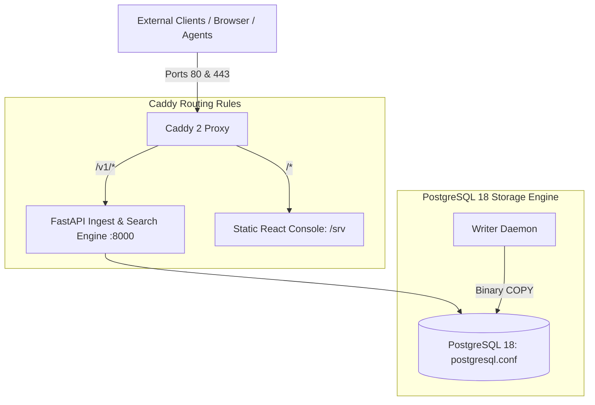

# Tailwatch Deployment & Infrastructure

Production infrastructure configuration files for Tailwatch, including the Caddy 2 reverse proxy, TLS termination, static asset routing, and high-throughput PostgreSQL 18 storage engine tuning.

---

## 1. Edge & Storage Topology

---

## 2. Component Reference

| File | Purpose |
| :--- | :--- |
| `caddy/Caddyfile` | Reverse proxy configuration routing API calls to the backend on `:8000` and serving pre-built React frontend assets with client-side fallback routing (`try_files {path} /index.html`). |
| `postgres/postgresql.conf` | PostgreSQL 18 configuration tuned for write-heavy log workloads, setting synchronous commits, checkpoint completions, and memory allocations. |

---

## 3. Storage Optimization & Tuning

The PostgreSQL 18 configuration is optimized for append-only time-series data:
- **Shared Buffers & Cache**: Configured to maximize block caching for index and partition lookups.
- **WAL & Checkpoint Management**: Checkpoint segments and completion targets are tuned to prevent I/O write spikes during sustained high-concurrency ingestion bursts.
- **Partition Pruning**: Daily range tables (`logs_pYYYYMMDD`) allow the database query planner to eliminate non-matching partitions during time-bounded TQL queries.

