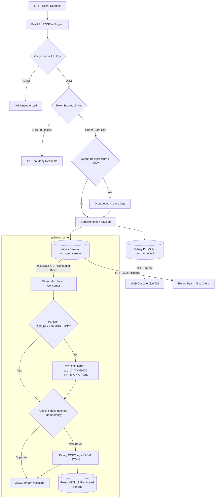
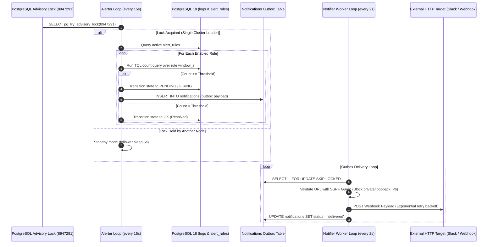
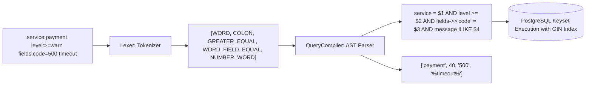

# Tailwatch Server

The core backend service for Tailwatch, written in Python with FastAPI, psycopg3, and Valkey. The server encompasses the high-throughput ingestion endpoint, the TQL query compiler, the asynchronous writer daemon, the advisory-locked alerting engine, the SSRF-guarded outbox notifier, and the automated partition lifecycle maintenance worker.

---

## 1. System Architecture & Workflows

### Ingestion & Stream Pipeline



---

### Alerting & Outbox Notification Flow



---

### Tailwatch Query Language (TQL) Compilation



---

## 2. Component Breakdown: What Each File Does

| Path | Component | Responsibility |
| :--- | :--- | :--- |
| `cli.py` | **CLI Entrypoint** | Command-line router dispatching subcommands: `api`, `writer`, `worker`, `alerter`, `notifier`, `maintenance`, `migrate`, and `seed`. |
| `api/main.py` | **FastAPI Application** | Bootstraps middleware, CORS policies, healthcheck probes (`/health/live`, `/health/ready`), and mounts all route handlers. |
| `api/deps.py` | **Authentication Dependencies** | Extracts `Authorization: Bearer <API_KEY>` headers and computes SHA-256 digests for credential verification. |
| `api/routes/ingest.py` | **Ingestion Router** | Validates incoming JSON batches, enforces 10,000 req/s token-bucket rate limits, executes load shedding, tracks host heartbeats, and enqueues to Valkey. |
| `api/routes/search.py` | **Search Router** | Compiles incoming TQL queries into parameterized SQL, applies keyset cursor pagination (`(ts, id) < ($1, $2)`), and fetches surrounding context logs. |
| `api/routes/histogram.py` | **Histogram Aggregator** | Computes date-binned density histograms (`date_bin`) grouped by severity levels across 15-minute time windows. |
| `api/routes/tail.py` | **Live Tail SSE** | Subscribes to Valkey Pub/Sub channel `tw:channel:tail` and streams events directly to connected web clients over Server-Sent Events. |
| `api/routes/auth.py` | **Session & User Auth** | Manages administrator initial setup, Argon2id password authentication, session issuance, and cookie validation. |
| `api/routes/alerts.py` | **Alert Rules API** | CRUD endpoints for managing alert rules, threshold values, evaluation windows, and severity levels. |
| `api/routes/telemetry.py` | **Telemetry & System Status** | Provides live host status from Valkey heartbeat keys (`tw:host:*`) and platform metrics (buffer memory, partition counts). |
| `alerting/evaluator.py` | **Alert State Evaluator** | Single-leader alert rule evaluator coordinating via PostgreSQL advisory locks and executing time-window count checks. |
| `alerting/notifier.py` | **Outbox Notifier** | Asynchronous outbox worker dequeuing notifications (`SKIP LOCKED`), applying SSRF IP validation, and dispatching webhooks. |
| `maintenance/partitions.py` | **Partition Lifecycle** | Pre-creates daily partition tables 3 days ahead (`logs_pYYYYMMDD`) and drops expired partitions exceeding project retention policies. |
| `writer/consumer.py` | **High-Speed Writer** | Consumes microbatches from Valkey Streams, ensures batch idempotency, and streams records into PostgreSQL using binary `COPY FROM STDIN`. |
| `query/lexer.py` | **TQL Lexer** | Tokenizes search strings into operators, words, quoted phrases, and comparison symbols. |
| `query/compiler.py` | **TQL Compiler** | Transforms token streams into parameterized SQL WHERE clauses, mapping severity names and JSON field accessors safely. |
| `core/config.py` | **Settings** | Pydantic configuration loader parsing environment variables (`TW_DATABASE_URL`, `TW_VALKEY_URL`, etc.). |
| `core/security.py` | **Cryptographic Primitives** | Argon2id password hashing, verification, cryptographically secure token generation, and SHA-256 digests. |
| `db/schema.sql` | **PostgreSQL DDL** | PostgreSQL 18 table definitions, range partitioning, GIN full-text indexes, and outbox tables. |

---

## 3. Project Directory Tree

```
server/
├── src/
│   └── tailwatch/
│       ├── alerting/
│       │   ├── evaluator.py      # Advisory lock evaluator & state machine
│       │   └── notifier.py       # SSRF-guarded webhook outbox dispatcher
│       ├── api/
│       │   ├── routes/
│       │   │   ├── alerts.py     # Alert rules CRUD endpoints
│       │   │   ├── auth.py       # Setup, login, session authentication
│       │   │   ├── histogram.py  # Time-bucket density aggregation
│       │   │   ├── ingest.py     # Log ingestion, rate limiting, load shedding
│       │   │   ├── projects.py   # Project settings and management
│       │   │   ├── search.py     # TQL search & surrounding context API
│       │   │   ├── tail.py       # Live tail Server-Sent Events (SSE)
│       │   │   └── telemetry.py  # Agent heartbeats & system health
│       │   ├── deps.py           # API key bearer authentication dependencies
│       │   └── main.py           # FastAPI app instance and router configuration
│       ├── core/
│       │   ├── config.py         # Environment configuration settings
│       │   └── security.py       # Argon2id password hashing and session tokens
│       ├── db/
│       │   └── schema.sql        # Partitioned tables, indexes, and constraints
│       ├── ingest/
│       │   └── models.py         # Pydantic request models & agent metadata
│       ├── maintenance/
│       │   └── partitions.py     # Auto-partition creation and retention cleanup
│       ├── query/
│       │   ├── compiler.py       # TQL to parameterized SQL compiler
│       │   └── lexer.py          # Lexical tokenizer for TQL expressions
│       ├── writer/
│       │   └── consumer.py       # Valkey stream reader & binary Postgres COPY worker
│       └── cli.py                # Multi-command CLI runner
├── tests/
│   ├── test_compiler.py          # TQL compiler unit tests
│   ├── test_rate_limiter.py      # Rate limiter & load-shedding unit tests
│   └── test_security.py          # Password hashing and token unit tests
├── Dockerfile                    # Container definition
├── pyproject.toml                # Package metadata and dependencies
└── README.md                     # Technical reference manual
```

---

## 4. CLI Usage

The server binary supports multiple operational subcommands:

```bash
# Run the FastAPI REST API
tailwatch api

# Run the high-speed Valkey-to-PostgreSQL binary COPY writer
tailwatch writer

# Run the unified background worker (Alerter + Notifier + Maintenance)
tailwatch worker

# Run standalone workers
tailwatch alerter
tailwatch notifier
tailwatch maintenance

# Apply database migrations
tailwatch migrate

# Seed database with default project and API key for local evaluation
tailwatch seed
```

---

## 5. Automated Tests

Run the server test suite:
```bash
python -m unittest discover -s server/tests
```
