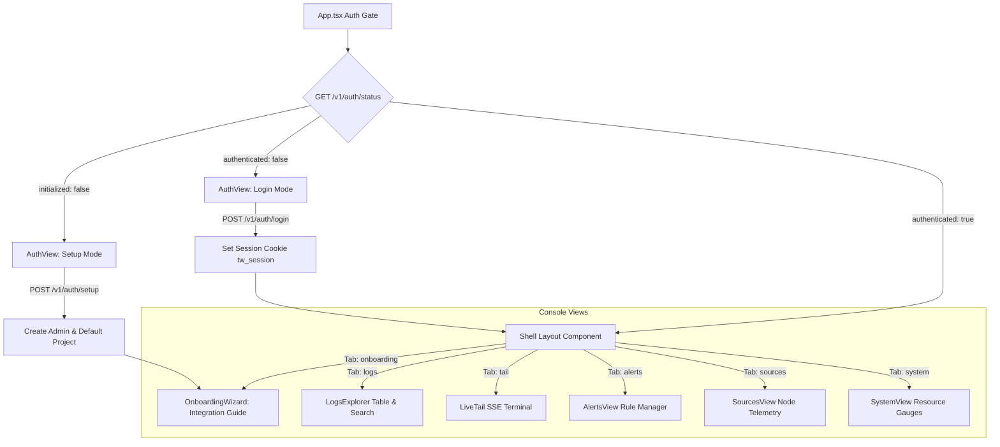
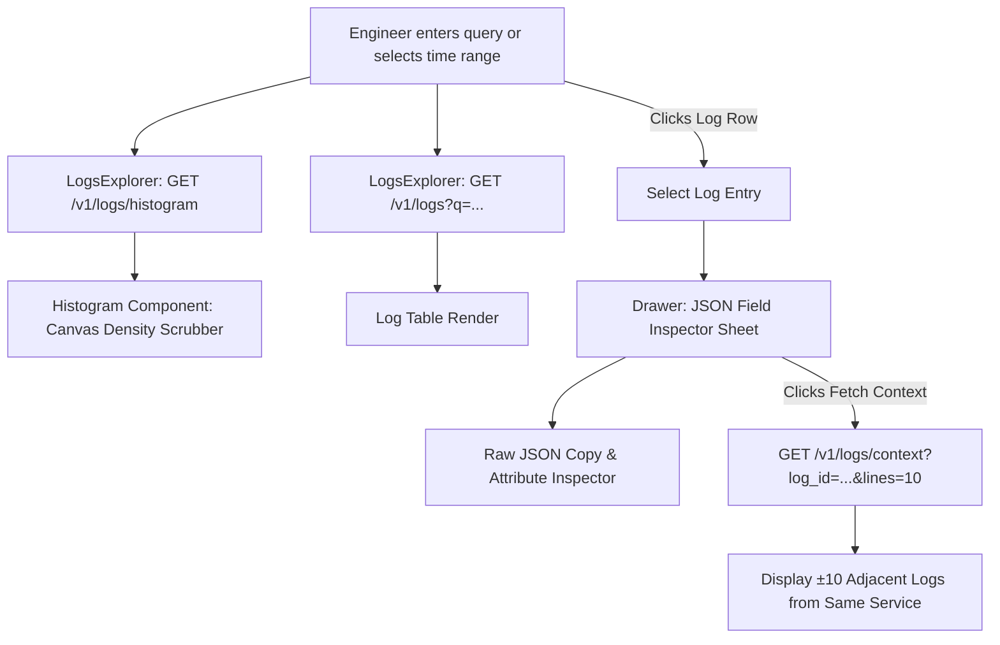

# Tailwatch Web Console

The frontend web application for Tailwatch, built with React 19, TypeScript, Vite, and pure CSS Modules. The console provides high-performance log searching, interactive canvas density scrubbing, real-time live tail streaming, alert management, and system infrastructure telemetry monitoring.

---

## 1. Application Architecture & Data Flow

### Application Routing & Authentication Gate



---

### Live Tail SSE Real-Time Streaming Flow

```mermaid
sequenceDiagram
    autonumber
    actor User as Engineer (Browser)
    participant LiveTail as LiveTail Component
    participant Caddy as Caddy Proxy (:80)
    participant API as FastAPI Live Tail Endpoint
    participant Valkey as Valkey Pub/Sub (tw:channel:tail)

    User->>LiveTail: Opens Live Tail Tab
    LiveTail->>Caddy: GET /v1/logs/tail (Accept: text/event-stream)
    Caddy->>API: Proxy SSE Request
    API->>Valkey: Subscribe to "tw:channel:tail"
    loop For Each Ingested Event
        Valkey-->>API: Message published
        API-->>LiveTail: event: log\ndata: { ... }\n\n
        LiveTail->>LiveTail: Append to terminal buffer (capped at 500 lines)
        LiveTail->>User: Auto-scroll terminal view
    end
    Note over User,LiveTail: User clicks Pause: close EventSource; clicks Resume: reconnect
```

---

### Log Explorer Deep Inspection & Surrounding Context Flow



---

## 2. Component Breakdown: What Each File Does

| Path | Component | Responsibility |
| :--- | :--- | :--- |
| `App.tsx` | **Root Gate & Coordinator** | Evaluates `/v1/auth/status`, switches between Setup, Login, and Authenticated Shell views, and manages global tab routing. |
| `components/layout/Shell/Shell.tsx` | **Main Shell Layout** | Renders top navigation bar, active project indicator, tab selectors, light/dark theme toggle, and user logout action. |
| `components/ui/Button/Button.tsx` | **Button Component** | Reusable button supporting `primary`, `secondary`, `ghost`, and `danger` variants, icon slots, and loading spinners. |
| `components/ui/Input/Input.tsx` | **Input Component** | Clean styled input component supporting text, password, icons, and keyboard shortcuts. |
| `components/ui/LevelPill/LevelPill.tsx` | **Level Pill** | Color-coded severity badge mapping numeric levels (10 to 60) to `TRACE`, `DEBUG`, `INFO`, `WARN`, `ERROR`, and `FATAL`. |
| `components/ui/StatusChip/StatusChip.tsx` | **Status Chip** | System state indicator displaying `OK`, `PENDING`, `ALERT`, or `RESOLVED` states. |
| `components/ui/Histogram/Histogram.tsx` | **Density Histogram** | Canvas-rendered density scrubber featuring mouse drag-to-brush time range selection and severity breakdown colors. |
| `components/ui/Drawer/Drawer.tsx` | **Detail Drawer** | Slide-over inspector sheet rendering message text, standard attributes, nested JSON keys, clipboard copy, and surrounding context. |
| `components/ui/Toast/Toast.tsx` | **Toast Notification Bus** | Zero-dependency toast manager and context hook (`useToast`) providing non-intrusive operational notifications. |
| `features/logs/LogsExplorer/LogsExplorer.tsx` | **Logs Explorer View** | Main query search view coordinating search inputs, histogram scrubbers, tabular results, and row inspection drawers. |
| `features/tail/LiveTail/LiveTail.tsx` | **Live Tail Streaming View** | Real-time terminal streaming logs over SSE with pause/resume controls, buffer counts, and auto-scrolling terminal window. |
| `features/alerts/AlertsView/AlertsView.tsx` | **Alerts Manager** | View and create threshold-based alert rules with evaluation time windows, query filters, and active rule toggles. |
| `features/sources/SourcesView/SourcesView.tsx` | **Sources Telemetry** | Displays connected agent nodes, IP addresses, versions, ingest rates, spool buffer percentages, and heartbeats. |
| `features/system/SystemView/SystemView.tsx` | **System Status Dashboard** | Pipeline visual strip, Valkey buffer memory gauge, PostgreSQL partition table counts, and disk space health indicators. |
| `features/auth/AuthView.tsx` | **Authentication Card** | Dual-mode authentication card supporting initial platform setup and subsequent user login. |
| `features/onboarding/OnboardingWizard.tsx` | **Integration Wizard** | Code snippet integration guides with copy-paste templates for Docker Engine, Node.js, Python, and cURL clients. |

---

## 3. Design System (60-30-10 Token Standard)

The user interface follows strict design tokens defined in `src/styles/tokens.css`:
- **60% Primary Surface**: Clean dark mode `#000000` surface with high-contrast `#ffffff` in light mode.
- **30% Structure**: Subtle borders (`--border: #222222`), raised cards (`--surface-raised: #111111`), and muted text.
- **10% Functional Accents**: Sky blue action accent (`--accent: #0070f3`), signal green (`--success: #10b981`), amber warn (`--warning: #f59e0b`), and crimson error (`--danger: #ef4444`).
- **Typography**: Inter system typography combined with tabular figures (`font-variant-numeric: tabular-nums`) across all timestamps and metrics.

---

## 4. Project Directory Tree

```
web/
├── src/
│   ├── components/
│   │   ├── layout/
│   │   │   └── Shell/
│   │   │       ├── Shell.tsx             # Shell header, project switcher, tabs
│   │   │       └── Shell.module.css
│   │   └── ui/
│   │       ├── Button/                   # Primary, secondary, ghost buttons
│   │       ├── Drawer/                   # Slide-out JSON inspector & context viewer
│   │       ├── Histogram/                # Canvas density scrubber with mouse brush
│   │       ├── Input/                    # Search & form text inputs
│   │       ├── LevelPill/                # Severity indicators
│   │       ├── StatusChip/               # System state indicator chips
│   │       └── Toast/                    # Toast notification context provider
│   ├── features/
│   │   ├── alerts/
│   │   │   └── AlertsView/               # Alert rules table and creation modal
│   │   ├── auth/
│   │   │   ├── AuthView.tsx              # Setup & login authentication cards
│   │   │   └── AuthView.module.css
│   │   ├── logs/
│   │   │   └── LogsExplorer/             # Main log search table with drawer integration
│   │   ├── onboarding/
│   │   │   ├── OnboardingWizard.tsx      # Copy-paste setup guides (Docker, cURL)
│   │   │   └── OnboardingWizard.module.css
│   │   ├── sources/
│   │   │   └── SourcesView/              # Agent nodes telemetry and heartbeats
│   │   ├── system/
│   │   │   └── SystemView/               # Queue memory & partition health gauges
│   │   └── tail/
│   │       └── LiveTail/                 # Live SSE streaming terminal
│   ├── styles/
│   │   ├── globals.css                   # Resets and typography defaults
│   │   └── tokens.css                    # Design tokens (colors, spacing, radii)
│   ├── App.tsx                           # Master view coordinator & auth gate
│   ├── main.tsx                          # React 19 bootstrap entrypoint
│   └── vite-env.d.ts                     # TypeScript declarations
├── package.json                          # Dependencies & build scripts
├── tsconfig.json                         # Strict TypeScript configuration
├── vite.config.ts                        # Vite bundler configuration
├── Dockerfile                            # Asset build container
└── README.md                             # Technical reference manual
```

---

## 5. Development and Build

### Install Dependencies
```bash
npm install
```

### Run Local Development Server
```bash
npm run dev
```

### Build Production Bundle
```bash
npm run build
```
*(Runs TypeScript validation followed by Vite production optimization)*.
