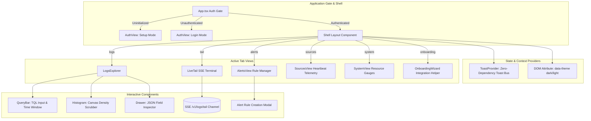

# Tailwatch Web

The frontend console for Tailwatch, built with React 19, TypeScript, Vite, and CSS Modules. The interface provides log exploration, high-DPI canvas histogram scrubbing, real-time live tail streaming, alert management, and system telemetry monitoring.

## Application Architecture



## Design System

The interface adheres to strict design and interaction tokens defined in `src/styles/tokens.css`:

- **Palette**: Follows the 60-30-10 rule.
  - 60% Neutral Surface: Pure black `#000000` in dark mode and clean white `#ffffff` in light mode.
  - 30% Structural Hierarchy: Subtle borders (`#1a1a1a` to `#333333`), layered card backgrounds, and muted typography.
  - 10% Functional Accent: Blue accent (`#0070f3`) for primary actions and queries, with dedicated status colors for log severities.
- **Pure CSS Modules**: Zero Tailwind CSS, zero external UI libraries (no Radix, MUI, or Chakra). Each component is self-contained within its own directory featuring `[Component].tsx` and `[Component].module.css`.
- **Typography**: Inter font family with tabular figures (`font-variant-numeric: tabular-nums`) applied across timestamps, latencies, and counts.
- **Theme Support**: Seamless runtime switching between Dark and Light modes persisted via DOM data attributes.

## Project Structure

```
web/
├── src/
│   ├── components/
│   │   ├── layout/
│   │   │   └── Shell/
│   │   │       ├── Shell.tsx             # Main header, project badge, navigation, theme toggle
│   │   │       └── Shell.module.css      # Pure CSS layout and navigation tokens
│   │   └── ui/
│   │       ├── Button/                   # Primary, secondary, ghost, danger buttons
│   │       ├── Input/                    # Styled text and password inputs
│   │       ├── LevelPill/                # Severity indicators (fatal, error, warn, info, debug)
│   │       ├── StatusChip/               # System state chips (ok, pending, alert)
│   │       ├── Histogram/                # Canvas histogram with brush-to-zoom mouse scrubbing
│   │       ├── QueryBar/                 # TQL search box and preset time-range selector
│   │       ├── Drawer/                   # Slide-over log detail view with raw JSON viewer
│   │       └── Toast/                    # Zero-dependency toast manager and context hook
│   ├── features/
│   │   ├── logs/
│   │   │   └── LogsExplorer/             # Paginated search results table and histogram sync
│   │   ├── tail/
│   │   │   └── LiveTail/                 # Real-time SSE live tail log viewer
│   │   ├── alerts/
│   │   │   └── AlertsView/               # Alert rules listing, toggle switch, and creation modal
│   │   ├── sources/
│   │   │   └── SourcesView/              # Connected hosts, agent versions, and spool metrics
│   │   ├── system/
│   │   │   └── SystemView/               # Pipeline strip, Valkey buffer gauge, and partition count
│   │   ├── auth/
│   │   │   ├── AuthView.tsx              # Setup and sign-in forms
│   │   │   └── AuthView.module.css       # Clean Vercel-style card styles
│   │   └── onboarding/
│   │       ├── OnboardingWizard.tsx      # Integration tabs (Docker, Vercel, cURL) and key issuer
│   │       └── OnboardingWizard.module.css
│   ├── styles/
│   │   ├── tokens.css                    # Color tokens, spacing, typography, and border radius
│   │   └── globals.css                   # Root resets, typography defaults, scrollbars
│   ├── App.tsx                           # Master view coordinator, auth state, tab router
│   ├── main.tsx                          # React 19 bootstrap mount
│   └── vite-env.d.ts                     # Ambient TypeScript declarations for CSS modules
├── package.json                          # Dependencies and npm scripts
├── tsconfig.json                         # Strict TypeScript configuration
├── vite.config.ts                        # Vite bundler configuration
├── Dockerfile                            # Multi-stage asset build image
└── README.md                             # Web frontend manual
```

## Component Hierarchy

### Core Layout & Primitives (`src/components/`)
- **`Shell`**: Top-level application shell with brand mark, active project slug badge, view navigation tabs, theme toggle, and sign-out controls.
- **`Button`**: Keyboard-accessible button supporting primary, secondary, ghost, and danger variants with loading spinner states.
- **`Input`**: Standardized text input field with focus ring tokens and placeholder styling.
- **`LevelPill`**: Color-coded severity badge supporting `FATAL`, `ERROR`, `WARN`, `INFO`, `DEBUG`, and `TRACE`.
- **`StatusChip`**: Micro-badge for system status indicators (`OK`, `PENDING`, `ALERT`).
- **`Drawer`**: Animated slide-over sheet for inspecting full structured JSON payloads, timestamps, trace IDs, and copy actions.
- **`Toast`**: Zero-dependency notification system providing `showToast` via `ToastProvider`.

### Visualizations (`src/components/ui/Histogram/`)
- **`Histogram`**: High-DPI canvas component rendering chronological log density distributions with interactive mouse click-and-drag brush zooming.

### Feature Views (`src/features/`)
- **`LogsExplorer`**: Search table with keyset pagination, histogram synchronization, and instant log inspection drawer.
- **`LiveTail`**: Real-time log terminal powered by Server-Sent Events (SSE) with auto-scroll freeze on hover.
- **`AlertsView`**: Alert rules registry, rule creation modal, and threshold condition editor.
- **`SourcesView`**: Live host dashboard displaying connected agent versions, IPs, spool utilization, and ingestion rates.
- **`SystemView`**: Platform overview with pipeline stage health indicators, Valkey buffer memory gauge, microbatch writer lag, and daily partition count.
- **`AuthView`**: Clean onboarding and authentication gate supporting first-time owner initialization and subsequent login.
- **`OnboardingWizard`**: Copyable configuration snippets for Docker agent, Vercel Serverless, and cURL endpoints with first-log detection polling.

## Development

### Setup & Run

```bash
cd web
npm install
npm run dev
```

The development server runs at `http://localhost:5173`. When testing against the API, configure proxy settings in `vite.config.ts` or run via Docker Compose where Caddy proxies port 80.

### Production Build

```bash
npm run build
```

Generates optimized, minified production assets in the `dist/` directory.
